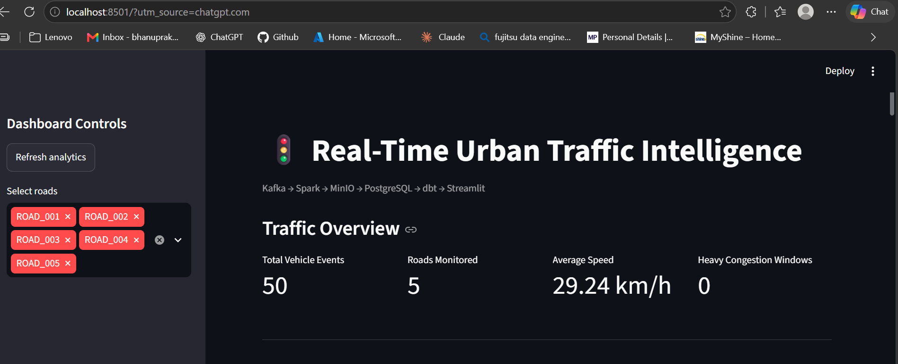
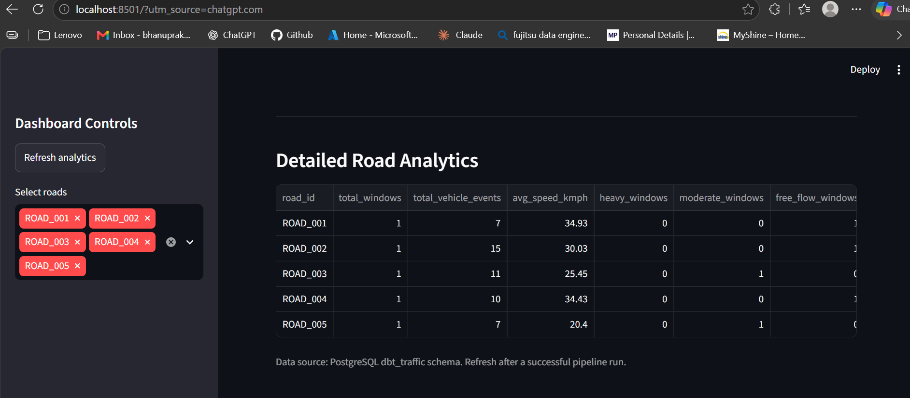
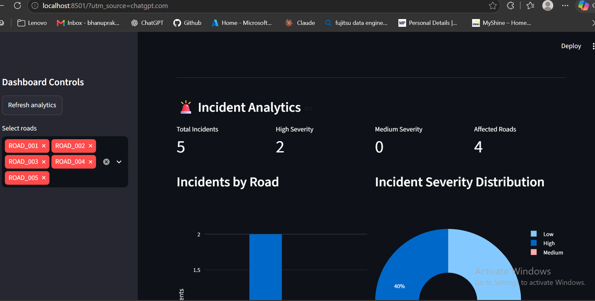
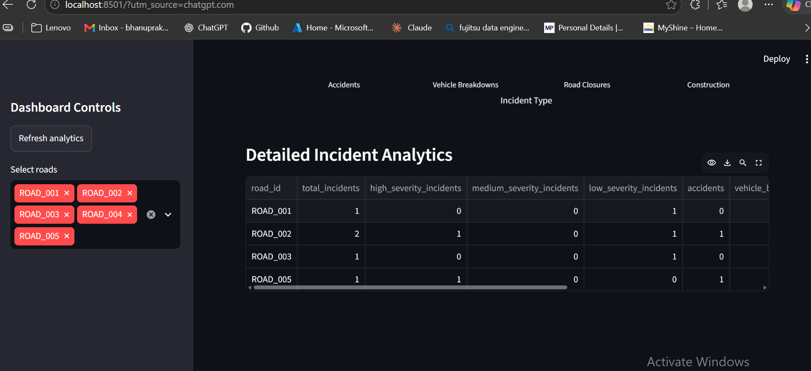

# 🚦 Real-Time Urban Traffic Intelligence Platform

An end-to-end, locally deployed **Data Engineering platform** that simulates urban traffic activity, streams vehicle and road incident events through Apache Kafka, processes them with Apache Spark, and delivers analytics through PostgreSQL, dbt, and an interactive Streamlit dashboard.

Built using open-source technologies without requiring AWS, Azure, or GCP.

## 📌 Problem Statement

Urban traffic conditions change because of vehicle movement, accidents, breakdowns, construction, and road closures.

To analyze these conditions effectively, traffic data must be collected, processed, validated, and transformed into meaningful insights.

This project demonstrates how a modern data engineering platform can process simulated traffic events and generate road-level congestion and incident analytics.

## 🎯 Project Objectives

- Simulate vehicle movement and road incident events.
- Publish event streams to Apache Kafka.
- Ingest Kafka messages using Spark Structured Streaming.
- Implement Bronze, Silver, and Gold data layers using MinIO and Parquet.
- Validate incoming records and isolate invalid data.
- Calculate road-level congestion and incident metrics.
- Load aggregated datasets into PostgreSQL.
- Build analytics models and automated tests using dbt.
- Orchestrate the complete pipeline using Apache Airflow.
- Visualize results using Streamlit and Plotly.
- Maintain data isolation between individual pipeline runs.
- Run the complete platform locally using Docker.

## 🛠️ Technology Stack

| Technology | Purpose |
|---|---|
| Python | Vehicle and incident event simulation |
| Apache Kafka | Event streaming and message buffering |
| Apache Spark / PySpark | Streaming ingestion and distributed transformations |
| MinIO | S3-compatible object storage |
| Apache Parquet | Columnar data storage |
| PostgreSQL | Analytical database |
| dbt | SQL transformations and data-quality tests |
| Apache Airflow | Pipeline orchestration |
| Docker / Docker Compose | Containerized infrastructure |
| Streamlit | Interactive analytics dashboard |
| Plotly | Data visualization |
| Git / GitHub | Version control |

## 🏗️ System Architecture

```text
                  Python Traffic Simulator
                            |
                  +---------+---------+
                  |                   |
             Vehicle Events      Incident Events
                  |                   |
                  v                   v
          Kafka Vehicle Topic  Kafka Incident Topic
                  |                   |
                  v                   v
             Spark Structured Streaming
                            |
                            v
                    MinIO Data Lake
                            |
          +-----------------+-----------------+
          |                 |                 |
          v                 v                 v
        BRONZE            SILVER             GOLD
     Raw Kafka data   Validated data    Aggregated metrics
          |                 |                 |
          +-----------------+-----------------+
                            |
                            v
                       PostgreSQL
                            |
                            v
                       dbt Models
                            |
                            v
                   Streamlit Dashboard

        Apache Airflow orchestrates the pipeline
```

The vehicle and incident streams are processed through separate transformations before being loaded into PostgreSQL and exposed through dbt models.

## 🔄 Data Processing Architecture

### Bronze Layer — Raw Data Ingestion

Spark Structured Streaming consumes events from two Kafka topics:

- `traffic.vehicle.events`
- `traffic.incident.events`

Incoming Kafka messages are stored in MinIO as Parquet files, preserving the raw JSON payload and Kafka metadata such as topic, partition, offset, and timestamp.

Bronze provides a raw record of ingested events for subsequent processing.

### Silver Layer — Data Cleaning and Validation

The Silver layer transforms raw JSON messages into structured datasets.

Processing includes:

- Parsing event fields using predefined schemas.
- Validating required fields.
- Validating incident types and severity values.
- Converting timestamps into appropriate data types.
- Removing duplicate events.
- Separating rejected records into quarantine storage.
- Filtering records using the current pipeline `run_id`.

**Run isolation:** Each Airflow execution generates a unique run identifier. Silver processing uses that identifier to ensure that current-run analytics do not include records from previous runs.

### Gold Layer — Business Analytics

The Gold layer generates analytics-ready datasets.

**Vehicle analytics**

- Average vehicle speed by road.
- Number of vehicle events.
- Window-based traffic aggregations.
- Congestion classification.
- Road-level traffic summaries.

**Incident analytics**

- Total incidents by road.
- High-, medium-, and low-severity incident counts.
- Accident counts.
- Vehicle breakdown counts.
- Road closure counts.
- Construction incident counts.

These aggregated datasets are stored in MinIO before being loaded into PostgreSQL.

## 🗄️ PostgreSQL and dbt Analytics

Gold datasets are loaded into PostgreSQL tables:

- `analytics.traffic_analytics`
- `analytics.incident_summary`

dbt transforms the source tables into reporting models.

| dbt Model | Purpose |
|---|---|
| `stg_traffic_analytics` | Staging view of traffic Gold data |
| `road_congestion_summary` | Road-level congestion analytics |
| `stg_incident_summary` | Staging view of incident Gold data |
| `road_incident_summary` | Road-level incident analytics |

The incident mart also calculates the percentage of incidents classified as high severity.

### Data Quality

The platform implements validation at multiple stages:

- Schema and field validation in PySpark.
- Duplicate-event handling.
- Quarantine storage for rejected records.
- Current-run filtering.
- Validation of the expected vehicle event count.
- dbt `not_null`, `unique`, and accepted-value tests.

## ⏱️ Apache Airflow Orchestration

The `traffic_intelligence_pipeline` DAG coordinates the complete workflow.

The pipeline contains **13 tasks**:

1. `start_pipeline`
2. `generate_traffic_events`
3. `ingest_kafka_to_bronze`
4. `ingest_incidents_to_bronze`
5. `transform_bronze_to_silver`
6. `transform_incidents_to_silver`
7. `transform_silver_to_gold`
8. `transform_incidents_to_gold`
9. `load_gold_to_postgres`
10. `load_incident_gold_to_postgres`
11. `check_traffic_data`
12. `run_dbt_models`
13. `validate_setup`

Each manually triggered DAG run generates **50 vehicle events** and a variable number of incident events.

Airflow coordinates ingestion, transformations, database loading, dbt execution, and final validation.

## 📊 Streamlit Analytics Dashboard

The dashboard connects to PostgreSQL's dbt reporting models and provides interactive traffic and incident analytics.

### Traffic Overview

Displays:

- Total vehicle events.
- Roads monitored.
- Average vehicle speed.
- Heavy congestion windows.



### Traffic Analytics

Includes:

- Average speed by road.
- Vehicle events by road.
- Congestion distribution.
- Traffic speed over time.
- Detailed road-level analytics.



### Incident Analytics

Displays:

- Total incidents.
- High-severity incidents.
- Medium-severity incidents.
- Affected roads.
- Incidents by road.
- Severity distribution.
- Incident type distribution.
- Detailed incident analytics.





The dashboard also supports filtering by road and manually refreshing analytics.

## 🧪 Verified Pipeline Results

The platform has been tested using multiple Airflow executions.

| Metric | First Verified Run | Second Verified Run |
|---|---:|---:|
| Vehicle events | 50 | 50 |
| Roads monitored | 5 | 5 |
| Total incidents | 5 | 5 |
| High-severity incidents | 1 | 2 |
| Medium-severity incidents | 1 | 0 |
| Roads affected by incidents | 3 | 4 |

The second run produced a different incident distribution, and the dashboard reflected the updated results.

These results demonstrate the pipeline's ability to refresh its analytical datasets across executions.

## 🚀 Running the Project Locally

### Prerequisites

- Docker Desktop with Docker Compose
- Python 3
- Git
- WSL2 with Ubuntu (recommended for Windows users)
- Sufficient memory for Kafka, Spark, PostgreSQL, MinIO, Airflow, and the dashboard

### 1. Clone the Repository

```bash
git clone https://github.com/Bhanu73120/real-time-urban-traffic-intelligence.git
cd real-time-urban-traffic-intelligence
```

### 2. Configure Environment Variables

Create a local `.env` file based on `.env.example` and configure the required MinIO and PostgreSQL credentials.

```bash
cp .env.example .env
```

Do not commit `.env` or other secret files.

### 3. Build Required Images

```bash
docker compose build spark-gold-loader dbt dashboard
```

### 4. Start the Infrastructure

```bash
docker compose --profile airflow up -d
```

Check service status:

```bash
docker compose --profile airflow ps
```

### 5. Open Apache Airflow

Visit:

http://localhost:8080

Locate the DAG:

`traffic_intelligence_pipeline`

Trigger a new run and monitor the tasks until completion.

### 6. Open Streamlit

Visit:

http://localhost:8501

Click **Refresh analytics** to load the latest processed results.

### 7. Stop the Platform

```bash
docker compose --profile airflow stop
```

Avoid removing Docker volumes if you want to preserve your Kafka, MinIO, and PostgreSQL data.

## 🔍 Example SQL Queries

### Total Vehicle Events

```sql
SELECT SUM(total_vehicle_events)
FROM dbt_traffic.road_congestion_summary;
```

### Incident Summary by Road

```sql
SELECT *
FROM dbt_traffic.road_incident_summary
ORDER BY road_id;
```

### Total Incidents

```sql
SELECT COALESCE(SUM(total_incidents), 0)
FROM analytics.incident_summary;
```

### High-Severity Incidents

```sql
SELECT
    road_id,
    high_severity_incidents,
    high_severity_percentage
FROM dbt_traffic.road_incident_summary
ORDER BY high_severity_incidents DESC;
```

## 💡 Engineering Challenges Addressed

**Kafka and Spark integration:** Configured Kafka topics, Spark streaming ingestion, and container networking to support reliable local event processing.

**Data validation:** Implemented structured transformations, deduplication, and quarantine handling to prevent invalid records from entering analytics.

**Pipeline run isolation:** Introduced unique run identifiers and run-based filtering to avoid mixing historical incidents with current-run analytics.

**Orchestration:** Integrated Spark processing, PostgreSQL loading, dbt models, and validation into a single Airflow DAG.

**End-to-end analytics:** Connected streaming ingestion and medallion transformations to an interactive dashboard using PostgreSQL and dbt.

## 🔮 Future Improvements

- Automated testing for zero-incident runs.
- Explicit run identifiers in PostgreSQL reporting tables.
- Historical trend analysis across multiple pipeline runs.
- Additional monitoring and alerting.
- Performance and load testing with larger event volumes.
- Automated CI checks using GitHub Actions.

## 📚 Key Learning Outcomes

This project demonstrates practical experience with:

- Event-driven data engineering.
- Kafka producers and consumers.
- Spark Structured Streaming.
- Medallion data architecture.
- Data validation and quality checks.
- Data lake storage using Parquet.
- PostgreSQL analytical workloads.
- dbt staging models, marts, and tests.
- Apache Airflow orchestration.
- Docker-based deployment.
- Interactive analytics and visualization.

## 👨‍💻 Author

**Bhanu Prakash**

GitHub: https://github.com/Bhanu73120

---

**Built as a hands-on Data Engineering portfolio project using open-source technologies and local infrastructure.**